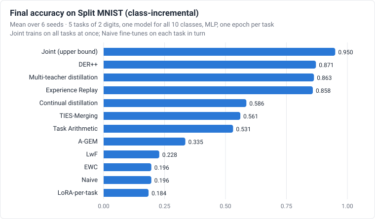

# contilab
{: .fs-9 }

지속 학습 연구를 위한 PyTorch 프레임워크입니다. 파국적 망각을 줄이는 방법들을 비전·언어 모델에서 비교하고,
모델 병합·지식 증류와도 같은 기준으로 견줍니다.
{: .fs-6 .fw-300 }

[시작하기](../wiki/Getting-Started.md){: .btn .btn-primary .fs-5 .mb-4 .mb-md-0 .mr-2 }
[실험 결과 보기](../wiki/Results.md){: .btn .fs-5 .mb-4 .mb-md-0 .mr-2 }
[English](../){: .btn .fs-5 .mb-4 .mb-md-0 }

---

**contilab**은 모델이 여러 태스크를 순서대로 학습할 때 앞서 배운 것을 얼마나 잊는지 측정합니다. 이 설정을
**지속 학습**(continual learning)이라 하며, 평생 학습·점진적 학습이라고도 부릅니다. contilab은 실증 연구를
위해 만들었습니다. 여러 시드·벤치마크·모델 크기에서 방법들을 공정하고 재현 가능하게 비교하는 것이 목표입니다.

- **방법 12종을 같은 기준으로 평가합니다.**
  - 순차 학습 방법: Naive 미세조정, Joint 학습, EWC, LwF, 경험 재생(ER), DER++, A-GEM, 태스크별 LoRA
  - 태스크별 전문가를 학습한 뒤 합치는 방법: Task Arithmetic, TIES-Merging, 다중 교사 증류, 교사 → 학생 연속 증류
  - 모든 방법을 같은 지표로 평가합니다.
- **지표 30여 종을 학습이 끝난 뒤 계산합니다.** 망각, 역방향·순방향 전이, 안정성 격차(stability gap), 선형
  프로브·CKA 표현 지표, 가소성 손실, 최근 태스크 편향, 보정(calibration), 소수 샷 회복, LLM 일반 능력 유지가
  포함됩니다. 원자료를 저장하므로 지표를 새로 추가해도 다시 학습할 필요가 없습니다.
- **통계 처리를 기본으로 제공합니다.**
  - 시드에 대한 평균 ± 표준편차와 부트스트랩 신뢰구간
  - 정확 쌍대 검정, 벤치마크 간 Friedman 검정과 Nemenyi 임계 차이 다이어그램
  - 하이퍼파라미터 탐색 결과를 검증 정확도로 선택
- **CPU에서도 빠릅니다.** 여러 시드를 `vmap` 앙상블 하나로 동시에 학습해, MLP에서 처리량이 3.8배가
  됩니다([Performance](../wiki/Performance.md), 영어).
- **비전과 언어 모두 지원합니다.** Split MNIST, Permuted MNIST, Split CIFAR-10/100, 그리고 Pythia·Qwen2.5 같은
  Hugging Face 언어 모델을 쓰는 text5를 제공합니다.

## 실험 결과 요약



CPU에서 방법 12종을 벤치마크 6종에 대해 실행했습니다. 모두 324회이며, 설정마다 시드 3~6개입니다.

- **리플레이 계열이 가장 우수합니다.** Joint 다음으로 DER++와 경험 재생의 평균 순위가 가장 높습니다(6개
  벤치마크 평균 2.7, 4.2, Friedman p = 6.6·10⁻⁶).
- **다중 교사 증류는 튜닝이 필요했습니다.** 검증 정확도로 고른 설정에서 Split MNIST(클래스 점진) 정확도가
  0.204에서 0.882로 올랐습니다. 이 설정을 기본값으로 쓰면 6시드 평균 0.863으로, DER++(0.871)와 유의한 차이가
  없습니다.
- **정규화 계열만으로는** 클래스 점진 학습에서 튜닝 후에도 Naive 수준에 머뭅니다. EWC 0.197, LwF 0.228,
  Naive 0.196입니다.
- **연속 증류는 전문가 모델을 저장하지 않습니다.** 2×100 크기의 작은 학생 모델이 0.34 MB로 Permuted MNIST에서
  원래 크기 모델 정확도의 98 %를 유지합니다.

모든 수치, 튜닝 비교, 실행별 CSV 파일은 [Results](../wiki/Results.md)(영어)에 있습니다.

## 빠른 시작

```bash
git clone https://github.com/JonPark0/contilab && cd contilab
python3 -m venv .venv && .venv/bin/pip install -e '.[dev]'

# 작은 합성 데이터로 모든 방법 실행 (4코어 CPU에서 1분 이내)
.venv/bin/contilab run configs/experiments/smoke_all.yaml
.venv/bin/contilab report runs/smoke_all          # runs/smoke_all/report.md, report.html

# 실제 벤치마크 하나: Split MNIST 클래스 점진, 방법 12종
.venv/bin/contilab run configs/experiments/cpu_main.yaml "matrix.preset=[split_mnist_class]"
```

[릴리스](https://github.com/JonPark0/contilab/releases)의 wheel 파일을 `pip`으로 설치해도 됩니다. 첫 실행과
보고서 읽는 법은 [Getting started](../wiki/Getting-Started.md)에, 자주 묻는 질문은 [FAQ](../wiki/FAQ.md)에
있습니다(영어).

## 포함된 기능

| 영역 | 내용 |
|---|---|
| 시나리오 | 태스크 점진(Task-IL), 클래스 점진(Class-IL), 도메인 점진(Domain-IL) |
| 방법 | Naive, Joint, EWC(online), LwF, 경험 재생, DER++, A-GEM, 태스크별 LoRA |
| 병합·증류 | Task Arithmetic, TIES-Merging, 다중 교사 증류, 교사 → 학생 연속 증류, 더 작은 학생 모델 |
| 벤치마크 | Split MNIST, Permuted MNIST, Split CIFAR-10, Split CIFAR-100, text5 (AG News → Yelp → Amazon → DBpedia → Yahoo Answers) |
| 지표 | 지표 30여 종과 그림 (정확도 히트맵, 안정성 격차 곡선, CKA, t-SNE, 손실 장벽, 임계 차이 다이어그램) |
| 엔지니어링 | `vmap` 시드 앙상블, `torch.compile`, bf16, 재개 가능한 실험 행렬, 실패 격리, Markdown·HTML 보고서 |

## 인용

```bibtex
@software{contilab2026,
  author  = {Park, Yeochoon},
  title   = {contilab: a performance-first framework for continual learning benchmarking, distillation and model merging},
  year    = {2026},
  version = {0.3.1},
  url     = {https://github.com/JonPark0/contilab}
}
```

소스 코드: <https://github.com/JonPark0/contilab> · 라이선스: MIT
