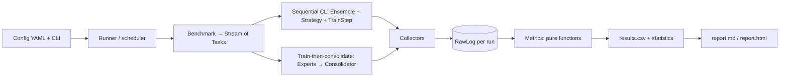

# Architecture

## Packages

| Package | Responsibility |
|---|---|
| `contilab.core` | `TensorSplit`, `Task`, `Stream`, `Batch`, `RunContext`, config dataclasses, scenario masks |
| `contilab.data` | Benchmark builders, on-disk tensor cache, `TrainPool` (all tasks' training data addressed by global index), DataLoader-free batching |
| `contilab.models` | `MLP`, `ReducedResNet18` (GroupNorm), `HFClassifier` (any Hugging Face causal LM + last-token head), in-house LoRA |
| `contilab.engine` | `Ensemble` (stacked parameters), `TrainStep` (vmapped / compiled loss, autograd, element-wise update), trainer loop, evaluator, device and precision selection |
| `contilab.strategies` | CL methods as plugins |
| `contilab.consolidate` | Expert training and caching, Task Arithmetic, TIES, multi-teacher distillation |
| `contilab.metrics` | `RawLog`, collectors, metric registry, metric families, statistics |
| `contilab.report` | Tables, figures, Markdown/HTML rendering |
| `contilab.runner` | Config loading and matrix expansion, execution, checkpoint resume, scheduling, CLI, throughput bench |

## The ensemble axis E

Every training tensor carries a leading member axis `E`. Runs that differ only by their seed form one group:

- parameters are stacked with `torch.func.stack_module_state` into `[E, ...]` leaf tensors;
- the model is evaluated with `vmap(functional_call(template, ...))` over members (E = 1 skips vmap);
- the loss is the **sum of per-member losses**, so gradients never mix between members;
- optimisers are element-wise (SGD, AdamW) and gradient clipping is per member, so member *i* of a group is
  numerically the same run as seed *i* trained alone (tested to `atol=1e-5`);
- per-member state — data order, replay buffers, Fisher information, snapshots — is stacked or kept per
  member generator.

A member whose loss becomes NaN or explodes is marked `diverged`, its gradients are zeroed and its parameters
restored after each optimiser step, so it cannot disturb the others.

## Strategies: hot path vs host side

A strategy implements a **per-member** `loss(p, s, batch, replay, f)` that the engine vmaps and compiles, and
host-side hooks (`before_task`, `replay_batch`, `after_step`, `after_task`, `eval_setup`) that run outside the
compiled region. See [Extending](Extending.md).

## Raw-log-first evaluation

Collectors record only raw data during training (per tier, see [Metrics](Metrics.md)). After the experiment,
`finalize_experiment` computes every metric from the stored records, so a new metric can be added with
`contilab metrics <exp> --add <name>` without re-training.
