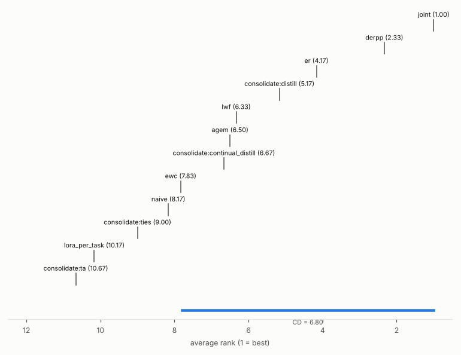
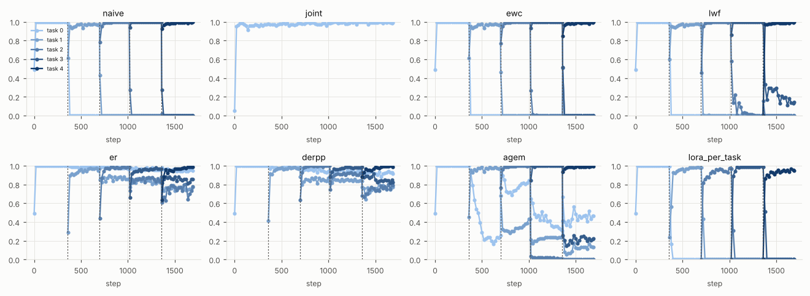
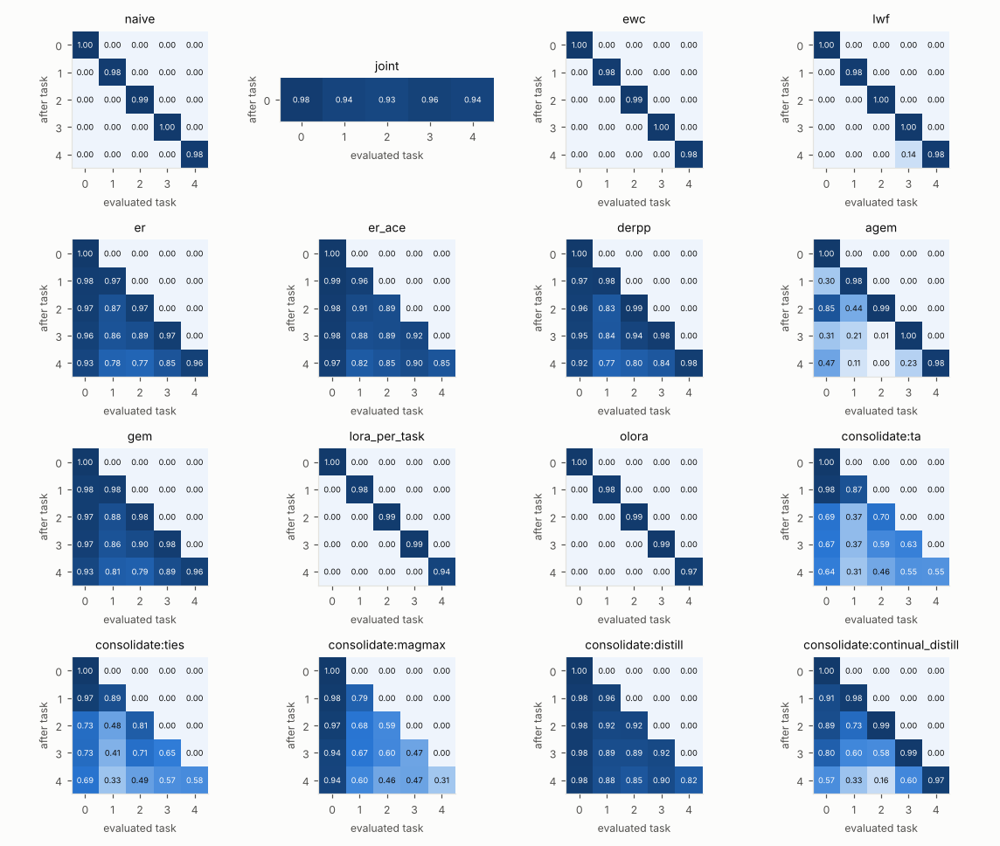
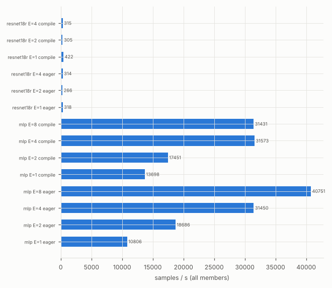

# Results: CPU study

An empirical comparison of 12 continual-learning methods on 6 benchmarks, run end to end on a 4-core CPU with
contilab. The page has four experiments:

| Experiment | Config | What it answers |
|---|---|---|
| Main study | `configs/experiments/cpu_main.yaml` (+ `cpu_main_seeds.yaml`) | All methods with default hyperparameters on 6 benchmarks |
| Tuned comparison | `configs/experiments/cpu_tuned.yaml` | The same methods when each one's hyperparameters are chosen on validation accuracy (two MNIST benchmarks) |
| Smaller student | `configs/experiments/cpu_student.yaml` | Distilling full-size experts into a student with 5.3× fewer parameters |
| text5 at the design scale | `configs/experiments/cpu_text5_full.yaml` | Whether the text5 results hold with 2,000 / 500 texts per task instead of 1,000 / 200 |

> **v0.2 update.** The results were refreshed after these changes:
> - Metric fixes: `cka_final`, `buffer_bytes`, and the continual-evaluation curves of Joint.
> - New distillation defaults, chosen on validation accuracy in the tuned comparison. The v0.1 defaults
>   under-trained the student.
> - A new method: teacher → student continual distillation.
>
> Accuracy numbers of the other methods are unchanged.

> **Update after v0.2.0.** Split CIFAR-100 joined the main study, and the three MNIST benchmarks have 6 seeds
> instead of 3, so exact paired tests there can reach p < 0.05. The runs of seeds 0–2 are unchanged. Two
> statements changed:
> - With 6 seeds, DER++ instead of multi-teacher distillation has the best mean on Split MNIST Class-IL. The two
>   do not differ significantly.
> - Continual distillation no longer beats Naive on every Class-IL benchmark: it falls below Naive on Split
>   CIFAR-100.
>
> The tuned comparison has 6 seeds as well; its selections hold, except that 30 distillation epochs now edge out
> 10 on Split MNIST Class-IL.

> **Update: EWC λ = 30, CIFAR without compile.** Two defaults changed, and the affected runs were re-run:
> - EWC on vision uses λ = 30, the value selected on validation accuracy in the tuned comparison, instead of the
>   literature default λ = 100. The 18 MNIST EWC runs were re-run.
> - The CIFAR presets train in bf16 without `torch.compile`: compile added no throughput at steady state and
>   took about 50 s per graph. All 72 Split CIFAR-10 and CIFAR-100 runs were re-run.
>
> The other runs are unchanged. Without compile the CIFAR runs follow a different numerical path, so every CIFAR
> number moved, for example Joint on Split CIFAR-10 from 0.398 ± 0.099 to 0.462 ± 0.017. What changed in the
> statements:
> - EWC trains stably on Permuted MNIST (0.832, above Naive's 0.805 on 5 of 6 seeds), but no longer leads Naive on
>   Split MNIST Class-IL (0.196 for both). Success criterion 3 now holds for LwF only.
> - EWC still diverges on Split CIFAR-10 (1 of 3 seeds) and Split CIFAR-100 (3 of 3), late in the task stream.
> - ER and DER++ no longer tie on Split CIFAR-100: DER++ reaches 0.063 and ER 0.057 (Naive 0.046).
> - Average ranks: DER++ 2.3 (was 2.7), multi-teacher distillation 5.0 (4.7), EWC 8.2 (9.5). DER++ is no longer
>   significantly ahead of EWC.

> **Update: EWC stiffness cap.** Under SGD, EWC's penalty multiplies a parameter's distance from its anchor by
> (1 − lr·λ·F) per step, and the online Fisher F only grows from task to task. Once lr·λ·F exceeds 2 the
> parameter oscillates with growing amplitude, which is how the divergences above came about. EWC now clamps the
> stored Fisher at 1 / (lr·λ) when the optimiser is SGD (see [Methods](Methods.md)). The 24 SGD EWC runs of the
> main study and the 72 runs of the tuned EWC sweep were re-run:
> - No run diverges any more: the main study has 324 done runs.
> - The MNIST results are unchanged except one Permuted MNIST seed, where the cap binds (0.8294 instead of 0.8287).
> - On CIFAR, EWC is stable but below Naive: 0.159 vs 0.182 on Split CIFAR-10 and 0.041 vs 0.046 on Split
>   CIFAR-100.
> - In the tuned comparison, λ = 100 and λ = 300 no longer diverge on Permuted MNIST (0.817 and 0.769), and
>   λ = 30 is still selected (0.832).
> - Average ranks: EWC 7.8 (was 8.2), multi-teacher distillation 5.2, continual distillation 6.7; Friedman
>   p = 5.8·10⁻⁶.

> **Update: text5 at the design scale.** text5 was run again with 2,000 training and 500 test texts per task, the
> scale of the original design. The method order holds (Spearman ρ = 0.97 between the method means), and most
> methods gain 0.01–0.05; see [text5 at the design scale](#text5-at-the-design-scale). The main-study tables keep
> the 1,000 / 200 runs.

## Setup

| | |
|---|---|
| Hardware | 4 CPU cores (Intel Xeon @ 2.1 GHz, AMX/AVX512-BF16), 15 GB RAM, no GPU |
| Main study | 12 methods × (3 MNIST benchmarks × 6 seeds + 3 other benchmarks × 3 seeds) = **324 runs**: 324 done, 0 diverged, 0 failed |
| Vision | Split MNIST (Class-IL and Task-IL) and Permuted MNIST (10 tasks, 10k/2k samples per task) with an MLP 2×400, 1 epoch, SGD lr 0.03; Split CIFAR-10 and Split CIFAR-100 (Class-IL; 5 × 2 and 10 × 10 classes) with a reduced ResNet-18, **2 epochs**, bf16 |
| Language | text5 (AG News → Yelp → Amazon → DBpedia → Yahoo, 33 classes) with **Pythia-70M**, **1,000 train / 200 test texts per task**, 1 epoch, AdamW lr 1e-4, batch 16 |
| Memory budget | 500 samples (vision) / 200 (text) for ER, DER++, A-GEM and both distillation methods |
| Distillation | multi-teacher: TIES-merged student, targets routed to each sample's teacher, 10 passes over the buffer; continual: one pass (`train.epochs`) over each task plus the buffer |
| Metrics tier | `full` on Split MNIST Class-IL, `extended` elsewhere; ρ = 20 (MNIST) / 50 (CIFAR, text) |

Deviations from the original design, all made to fit a CPU budget:

- CIFAR-10 and CIFAR-100 were trained for 2 epochs instead of 3.
- text5 used 1,000 training and 200 test texts per task, instead of 2,000 and 500. A separate run at the design
  scale gives the same method order; see [text5 at the design scale](#text5-at-the-design-scale).
- A-GEM on text used a 64-sample reference batch instead of 256.

## Accuracy overview

Final average accuracy (ACC), mean ± std over 6 seeds (MNIST benchmarks) or 3 seeds (CIFAR, text5).

| Method | Split MNIST (Class-IL) | Split MNIST (Task-IL) | Permuted MNIST (Domain-IL) | Split CIFAR-10 (Class-IL) | Split CIFAR-100 (Class-IL) | text5 + Pythia-70M (Class-IL) |
|---|---|---|---|---|---|---|
| Naive | 0.196 ± 0.000 | 0.980 ± 0.001 | 0.805 ± 0.011 | 0.182 ± 0.004 | 0.046 ± 0.004 | 0.097 ± 0.016 |
| Joint | 0.950 ± 0.002 | 0.993 ± 0.001 | 0.909 ± 0.006 | 0.462 ± 0.017 | 0.120 ± 0.006 | 0.529 ± 0.015 |
| EWC | 0.196 ± 0.000 | 0.981 ± 0.001 | 0.832 ± 0.015 | 0.159 ± 0.009 | 0.041 ± 0.002 | 0.105 ± 0.015 |
| LwF | 0.228 ± 0.005 | 0.990 ± 0.001 | 0.817 ± 0.010 | 0.171 ± 0.004 | 0.047 ± 0.002 | 0.105 ± 0.006 |
| ER | 0.858 ± 0.012 | 0.983 ± 0.001 | 0.869 ± 0.004 | 0.290 ± 0.027 | 0.057 ± 0.007 | 0.329 ± 0.038 |
| DER++ | 0.871 ± 0.014 | 0.991 ± 0.001 | 0.902 ± 0.002 | 0.285 ± 0.018 | 0.063 ± 0.007 | 0.397 ± 0.068 |
| A-GEM | 0.335 ± 0.013 | 0.984 ± 0.001 | 0.864 ± 0.006 | 0.180 ± 0.005 | 0.044 ± 0.004 | 0.100 ± 0.008 |
| LoRA-per-task | 0.184 ± 0.005 | 0.986 ± 0.002 | 0.619 ± 0.021 | 0.129 ± 0.001 | 0.015 ± 0.003 | 0.024 ± 0.002 |
| Task Arithmetic | 0.531 ± 0.019 | 0.979 ± 0.003 | 0.570 ± 0.038 | 0.151 ± 0.020 | 0.011 ± 0.001 | 0.034 ± 0.003 |
| TIES | 0.561 ± 0.020 | 0.983 ± 0.002 | 0.677 ± 0.012 | 0.160 ± 0.034 | 0.013 ± 0.002 | 0.033 ± 0.004 |
| Multi-teacher distill. | 0.863 ± 0.025 | 0.986 ± 0.001 | 0.773 ± 0.010 | 0.267 ± 0.005 | 0.040 ± 0.014 | 0.452 ± 0.013 |
| Continual distill. | 0.586 ± 0.070 | 0.980 ± 0.001 | 0.818 ± 0.005 | 0.229 ± 0.028 | 0.030 ± 0.004 | 0.331 ± 0.045 |



**Ranking across the 6 benchmarks (ACC):**

| Rank | Method |
|---|---|
| 1.0 | Joint |
| 2.3 | DER++ |
| 4.2 | ER |
| 5.2 | Multi-teacher distillation |
| 6.3 | LwF |
| 6.5 | A-GEM |
| 6.7 | Continual distillation |
| 7.8 | EWC |
| 8.2 | Naive |
| 9.0 | TIES |
| 10.2 | LoRA-per-task |
| 10.7 | Task Arithmetic |

The Friedman test gives p = 5.8·10⁻⁶, and the Nemenyi critical difference is 6.80 (α = 0.05). With 6
benchmarks the CD is still wide:

- Joint is significantly better than Naive, EWC, TIES, LoRA-per-task and Task Arithmetic.
- DER++ is significantly better than LoRA-per-task and Task Arithmetic.

Before v0.2, multi-teacher distillation ranked last (9.8) with under-trained defaults.

### Paired tests on the MNIST benchmarks

Exact Wilcoxon signed-rank tests over the 6 seeds (seed *i* of one method paired with seed *i* of the other).
With 6 pairs the smallest possible two-sided p is 0.031, reached when every seed agrees.

| Benchmark | A vs B | Mean ACC (A / B) | Seeds where B is higher | p |
|---|---|---|---|---|
| Split MNIST Class-IL | Naive vs EWC | 0.196 / 0.196 | 2 / 6 | 1 |
| Split MNIST Class-IL | EWC vs LwF | 0.196 / 0.228 | 6 / 6 | 0.031 |
| Split MNIST Class-IL | LwF vs ER | 0.228 / 0.858 | 6 / 6 | 0.031 |
| Split MNIST Class-IL | ER vs DER++ | 0.858 / 0.871 | 6 / 6 | 0.031 |
| Split MNIST Class-IL | DER++ vs Joint | 0.871 / 0.950 | 6 / 6 | 0.031 |
| Split MNIST Class-IL | Multi-teacher distill. vs DER++ | 0.863 / 0.871 | 3 / 6 | 0.69 |
| Split MNIST Class-IL | Multi-teacher distill. vs ER | 0.863 / 0.858 | 3 / 6 | 0.84 |
| Split MNIST Class-IL | Task Arithmetic vs TIES | 0.531 / 0.561 | 6 / 6 | 0.031 |
| Split MNIST Class-IL | Naive vs Continual distill. | 0.196 / 0.586 | 6 / 6 | 0.031 |
| Split MNIST Task-IL | LwF vs DER++ | 0.990 / 0.991 | 3 / 6 | 0.44 |
| Permuted MNIST | Naive vs EWC | 0.805 / 0.832 | 5 / 6 | 0.063 |
| Permuted MNIST | EWC vs LwF | 0.832 / 0.817 | 1 / 6 | 0.063 |
| Permuted MNIST | Naive vs LwF | 0.805 / 0.817 | 5 / 6 | 0.094 |
| Permuted MNIST | Naive vs Continual distill. | 0.805 / 0.818 | 5 / 6 | 0.063 |
| Permuted MNIST | Multi-teacher distill. vs Naive | 0.773 / 0.805 | 6 / 6 | 0.031 |
| Permuted MNIST | Multi-teacher distill. vs Continual distill. | 0.773 / 0.818 | 6 / 6 | 0.031 |
| Permuted MNIST | A-GEM vs ER | 0.864 / 0.869 | 5 / 6 | 0.094 |
| Permuted MNIST | Task Arithmetic vs TIES | 0.570 / 0.677 | 6 / 6 | 0.031 |

## Findings

1. **Replay and multi-teacher distillation lead.** The best non-Joint method on each benchmark:
   - DER++ on Split MNIST Class-IL (0.871), Split MNIST Task-IL (0.991) and Permuted MNIST (0.902). On Split
     MNIST Class-IL, multi-teacher distillation (0.863) does not differ significantly from it (p = 0.69); on
     Task-IL, neither does LwF (0.990, p = 0.44).
   - ER on Split CIFAR-10 (0.290, DER++ 0.285), and DER++ on Split CIFAR-100 (0.063, ER 0.057)
   - multi-teacher distillation on text5 (0.452)

   Average ranks: DER++ 2.3, ER 4.2, multi-teacher distillation 5.2. Replay also has the smallest stability gap,
   for example 0.150 (DER++) vs 0.995 for Naive on Split MNIST Class-IL.
2. **Multi-teacher distillation buys accuracy with experts.**
   - It keeps every task expert: 11 MB of stored models on Split MNIST against 1.8 MB for a single model.
   - It trains every expert as well: 1,915 s per text5 run against 1,044 s for DER++.
   - In return it forgets little and is well calibrated across tasks, with BWT −0.079 and task-recency bias 0.05
     on Split MNIST Class-IL.
   - On Permuted MNIST it falls below Naive on every seed (0.773 vs 0.805, p = 0.031): the 500-sample buffer
     leaves 50 samples for each of the 10 input distributions.
   - On Split CIFAR-100 it also falls below Naive (0.040 vs 0.046). The buffer holds 5 samples per class, and
     the student reaches a learning accuracy of only 0.102.
3. **Teacher → student continual distillation is the cheap variant.** It never stores an expert: the student is
   the only model kept (1.8 MB). It beats Naive on every Class- and Domain-IL benchmark except Split CIFAR-100:
   - Split MNIST Class-IL 0.586 vs 0.196 (all 6 seeds)
   - Permuted MNIST 0.818 vs 0.805 (5 of 6 seeds, p = 0.063), and ahead of multi-teacher distillation (0.773)
     on every seed
   - CIFAR-10 0.229 vs 0.182
   - text5 0.331 vs 0.097, on par with ER
   - Split CIFAR-100: 0.030 vs 0.046, below Naive

   Old knowledge reaches the student only through self-distillation on the buffer, so errors compound task by
   task: BWT −0.499 and recency bias 0.46 on Split MNIST Class-IL. With 10 tasks of 10 classes on CIFAR-100
   the recency bias reaches 1.0.
4. **Regularisation alone does not solve Class-IL.** EWC (0.196) and LwF (0.228) stay at the Naive level (0.196)
   on Split MNIST Class-IL, with task-recency bias ≈ 1.0: almost every old-task sample is predicted as a
   newest-task class. LwF is above Naive on all 6 seeds; EWC with λ = 30 is not (higher on 2 of 6 seeds,
   p = 1), and λ = 100 led by only 0.001. The same holds on text5 (0.105 vs 0.097), Split CIFAR-10 (LwF 0.171,
   EWC 0.159, Naive 0.182) and Split CIFAR-100 (LwF 0.047, EWC 0.041, Naive 0.046). Tuning does not change this (see
   [Tuned comparison](#tuned-comparison)).
5. **EWC needs its stiffness bounded under SGD.** With the literature default λ = 100 and an online
   (accumulated) Fisher, every seed diverged on Permuted MNIST, Split CIFAR-10 and Split CIFAR-100. λ = 30, chosen
   on validation accuracy, only delayed the divergence on CIFAR: one Split CIFAR-10 seed diverged in the last of
   5 tasks, and every Split CIFAR-100 seed in task 5, 9 or 10 of 10.
   - The cause: an SGD step multiplies a parameter's distance from its anchor by (1 − lr·λ·F), which oscillates
     with growing amplitude once lr·λ·F > 2, and the accumulated Fisher crosses that bound sooner or later. On
     Permuted MNIST with λ = 100 (seed 0) the largest lr·λ·F grew from 0.54 after the first task to 2.13 after the
     seventh, and the run diverged in the eighth.
   - With the Fisher clamped at 1 / (lr·λ), no run diverges. Permuted MNIST reaches 0.832 with λ = 30, above
     Naive (0.805) on 5 of 6 seeds (p = 0.063). On CIFAR the clamped EWC is stable but below Naive (0.159 vs
     0.182, 0.041 vs 0.046).
6. **A-GEM helps in Domain-IL but not in Class-IL.** It reaches 0.864 on Permuted MNIST but only 0.335 on Split
   MNIST Class-IL, and stays at the Naive level on CIFAR-10, CIFAR-100 and text5. This matches the known
   weakness of gradient projection under class-incremental output heads.
7. **Merging trails replay.**
   - TIES is above Task Arithmetic on every seed: 0.561 vs 0.531 on Split MNIST Class-IL, 0.677 vs 0.570 on
     Permuted MNIST (p = 0.031 each).
   - Merged models show little recency bias (0.13 on Split MNIST Class-IL), but learning accuracy drops to
     0.78–0.80 because the experts interfere. On Split CIFAR-100 the merged models are near chance (0.011–0.013).
   - As a starting point for distillation, the merged model is what made distillation work (see the tuned
     comparison).
8. **Task-IL is easy at this scale.** Every method reaches ≥ 0.979 on Split MNIST Task-IL.
9. **Language models trade task learning against general ability.**
   - Full fine-tuning methods raise the WikiText perplexity of the original LM head by +4,500 to +14,000.
   - LoRA-per-task (+186) and TIES (+1,709) keep it low but barely learn the tasks (learning accuracy
     0.21–0.25).
   - Multi-teacher distillation has the best balance: the highest text5 accuracy (0.452) at +3,643. At the design
     scale it holds: 0.477 at +3,703.
10. **LoRA-per-task on vision uses a frozen randomly initialised backbone** (no pretraining), which limits it to
    0.184 on Split MNIST Class-IL and 0.619 on Permuted MNIST. It is a meaningful baseline only with pretrained
    backbones.
11. **Split CIFAR-100 at 2 epochs is a floor test.** Joint reaches only 0.120 on 100 classes, so every continual
    method sits between chance (0.010) and 0.063. Only replay (DER++ 0.063, ER 0.057) is clearly above Naive
    (0.046); LwF (0.047) matches it. The rankings on this benchmark mostly reflect under-training, not
    forgetting.



*Continual evaluation on Split MNIST Class-IL: accuracy of each task over training steps. Dashed lines are task
boundaries. Naive, EWC, LwF and LoRA collapse to zero on old tasks immediately, while ER and DER++ keep them.*



## Tuned comparison

Defaults from the literature are not always good settings. `cpu_tuned` gives every method with hyperparameters a
small grid (`method_sweep`) on the two MNIST benchmarks:

- EWC: λ ∈ {1, 3, 10, 30, 100, 300}
- LwF: α ∈ {0.5, 1, 2, 4}
- DER++: α ∈ {0.1, 0.3, 1} × β ∈ {0.5, 1}
- TIES: k ∈ {0.1, 0.2, 0.5}
- Multi-teacher distillation: init {θ₀, TIES} × routing {entropy, routed} × epochs {1, 10, 30}

For each method, the variant with the best mean **validation** accuracy over seeds is selected (spec §5.3);
diverged seeds score 0. Optimiser, learning rate, epochs, batch size and memory budget stay fixed by the
fairness rules. "Default" is the literature default: λ = 100 for EWC and the v0.1 defaults for distillation. The
main study now uses λ = 30 and the selected distillation settings, with 10 instead of 30 epochs. This
experiment has 6 seeds, like the MNIST benchmarks of the main study, so its other default and untuned values are
the same as in the overview above.

| Method | Split MNIST Class-IL: selected | default | tuned | Permuted MNIST: selected | default | tuned |
|---|---|---|---|---|---|---|
| Naive | — | 0.196 | 0.196 | — | 0.805 | 0.805 |
| Joint | — | 0.950 | 0.950 | — | 0.909 | 0.909 |
| EWC | λ=300 | 0.197 | **0.201** | λ=30 | 0.817 | **0.832** |
| LwF | α=1 | 0.229 | **0.229** | α=0.5 | 0.816 | **0.828** |
| ER | — | 0.858 | 0.858 | — | 0.869 | 0.869 |
| DER++ | α=1, β=1 | 0.871 | **0.899** | α=0.3, β=1 | 0.902 | **0.906** |
| A-GEM | — | 0.335 | 0.335 | — | 0.864 | 0.864 |
| LoRA-per-task | — | 0.184 | 0.184 | — | 0.619 | 0.619 |
| Task Arithmetic | — | 0.531 | 0.531 | — | 0.570 | 0.570 |
| TIES | k=0.1 | 0.561 | **0.591** | k=0.2 | 0.677 | **0.677** |
| Multi-teacher distill. | epochs 30, TIES init, routed | 0.223 | **0.871** | epochs 30, TIES init, routed | 0.097 | **0.786** |
| Continual distill. | — | 0.586 | 0.586 | — | 0.818 | 0.818 |

- **Tuning changes the verdict for distillation.** The v0.1 defaults trained the student for 16 SGD steps per task
  from θ₀ with entropy-mixed targets. A TIES-merged start with routed targets lifts Split MNIST Class-IL from
  0.223 to 0.871 and Permuted MNIST from 0.097 to 0.786.
  - These settings are now the defaults, with 10 distillation epochs.
  - With 6 seeds, 30 epochs is selected on both benchmarks. It is 0.008 and 0.013 above 10 epochs (0.863 and
    0.773) and takes three times the distillation time, so the default stays at 10.
- **Tuning does not rescue regularisation in Class-IL.** No λ makes EWC differ from Naive on Split MNIST
  Class-IL (0.196–0.201), and no α lifts LwF above 0.230. On Permuted MNIST λ = 30 gives 0.832 (Naive 0.805)
  and is now EWC's default on vision. Without the stiffness cap, λ = 100 and λ = 300 diverged on every seed;
  with it they reach 0.817 and 0.769.
- DER++ gains 0.03 with stronger replay terms (α = β = 1: 0.899 against 0.871). TIES gains 0.03 with sparser task
  vectors (k = 0.1: 0.591 against 0.561) on Split MNIST Class-IL.
- Average ranks over the two benchmarks, using the selected variants:
  - Joint 1.0, DER++ 2.0, ER 3.5
  - A-GEM 6.0, multi-teacher distillation 6.0, continual distillation 6.5
  - EWC 7.5, LwF 7.5, TIES 7.5
  - Naive 9.5, TA 9.5, LoRA-per-task 11.5

  Two benchmarks are too few for significance (Friedman p = 0.13).

## Teacher → smaller student

`cpu_student` distils the 2×400 MLP experts (478k parameters) into a 2×100 student (89.6k parameters, 5.3×
fewer). A different architecture cannot start from merged expert weights, so both students start from their own
initialisation. The fair full-size reference for multi-teacher distillation is therefore the θ₀-initialised
variant of the tuned comparison. All rows use seeds 0–2.

| Method | Student | Split MNIST Class-IL | Permuted MNIST | Stored model bytes (Split / Permuted) |
|---|---|---|---|---|
| Multi-teacher distill. | full size (θ₀ init) | 0.856 | 0.534 | 10.9 / 20.1 MB (experts + student) |
| Multi-teacher distill. | 2×100 | 0.857 ± 0.010 | 0.464 ± 0.010 | 9.5 / 18.6 MB (experts + student) |
| Continual distill. | full size | 0.533 ± 0.038 | 0.816 ± 0.004 | 1.8 MB (student only) |
| Continual distill. | 2×100 | 0.490 ± 0.034 | 0.798 ± 0.001 | **0.34 MB** (student only) |

- On Split MNIST Class-IL the small student matches the full-size one (0.857 vs 0.856). Permuted MNIST (10 tasks,
  all 10 classes shared) costs it 0.07.
- Continual distillation never stores an expert. Its 2×100 student keeps 98 % of the full-size accuracy on
  Permuted MNIST, in 0.34 MB. That is the smallest deployable result in this study.

## text5 at the design scale

`cpu_text5_full` repeats the text5 benchmark of the main study at the scale of the original design: 2,000
training and 500 test texts per task instead of 1,000 and 200. Methods, seeds (0–2), optimiser, memory budget and
metric settings are those of the main study. The 36 runs took 19 h of training. Each text run has the whole
4-core CPU in both experiments, so their wall times are comparable.

| Method | ACC, 1,000 / 200 | ACC, 2,000 / 500 | Δ | BWT, 2,000 / 500 | Wall time |
|---|---|---|---|---|---|
| Naive | 0.097 ± 0.016 | 0.111 ± 0.007 | +0.015 | -0.596 | 461 → 940 s |
| Joint | 0.529 ± 0.015 | 0.556 ± 0.031 | +0.027 | — | 674 → 872 s |
| EWC | 0.105 ± 0.015 | 0.112 ± 0.008 | +0.007 | -0.586 | 1199 → 2187 s |
| LwF | 0.105 ± 0.006 | 0.124 ± 0.003 | +0.019 | -0.594 | 816 → 1127 s |
| ER | 0.329 ± 0.038 | 0.333 ± 0.029 | +0.004 | -0.346 | 733 → 1834 s |
| DER++ | 0.397 ± 0.068 | 0.372 ± 0.058 | -0.025 | -0.298 | 1044 → 2757 s |
| A-GEM | 0.100 ± 0.008 | 0.119 ± 0.006 | +0.019 | -0.595 | 1563 → 4063 s |
| LoRA-per-task | 0.024 ± 0.002 | 0.024 ± 0.003 | +0.001 | -0.326 | 755 → 1929 s |
| Task Arithmetic | 0.034 ± 0.003 | 0.044 ± 0.027 | +0.010 | -0.259 | 628 → 1421 s |
| TIES | 0.033 ± 0.004 | 0.040 ± 0.015 | +0.008 | -0.274 | 674 → 1444 s |
| Multi-teacher distill. | 0.452 ± 0.013 | 0.477 ± 0.008 | +0.025 | -0.062 | 1915 → 2275 s |
| Continual distill. | 0.331 ± 0.045 | 0.382 ± 0.017 | +0.051 | -0.245 | 916 → 1954 s |

- **The method order holds.** The rank correlation between the method means at the two scales is 0.97
  (Spearman). Joint and multi-teacher distillation lead at both. Continual distillation (0.382) and DER++ (0.372)
  swap third and fourth place, a difference well inside their spread over seeds.
- **Most methods gain 0.01–0.05.** DER++ is the exception (−0.025); it has the widest spread over seeds at both
  scales (0.317–0.433 at the design scale).
- **The groups stay apart.** Regularisation and A-GEM stay at the Naive level (0.112–0.124 vs 0.111), and
  LoRA-per-task, Task Arithmetic and TIES stay below it (0.024–0.044).
- **Multi-teacher distillation keeps the best balance** between the tasks and general ability: BWT −0.062 and
  WikiText perplexity +3,703, against +8,179 for Naive, +16,811 for ER and +227 for LoRA-per-task.
- **Cost.** Wall time grows 1.2–2.6× for 2× the training texts and 2.5× the test texts.

All metrics at the design scale (means over seeds 0–2):

| Method | acc | bwt | learning_acc | min_acc | stability_gap | general_ppl_delta | buffer_bytes | state_bytes | wall_time |
|---|---|---|---|---|---|---|---|---|---|
| Naive | 0.111 | -0.596 | 0.588 | 0.000 | 0.517 | +8179 | 0 | 0 | 940 s |
| Joint | 0.556 | — | — | — | — | +5162 | 0 | 0 | 872 s |
| EWC | 0.112 | -0.586 | 0.581 | 0.000 | 0.514 | +9673 | 0 | 340.94 MB | 2187 s |
| LwF | 0.124 | -0.594 | 0.599 | 0.000 | 0.526 | +8826 | 0 | 268.72 MB | 1127 s |
| ER | 0.333 | -0.346 | 0.609 | 0.246 | 0.143 | +16811 | 0.39 MB | 0 | 1834 s |
| DER++ | 0.372 | -0.298 | 0.610 | 0.279 | 0.198 | +8290 | 0.42 MB | 0 | 2757 s |
| A-GEM | 0.119 | -0.595 | 0.595 | 0.001 | 0.520 | +9349 | 0.39 MB | 0 | 4063 s |
| LoRA-per-task | 0.024 | -0.326 | 0.285 | 0.000 | 0.282 | +227 | 0 | 0 | 1929 s |
| Task Arithmetic | 0.044 | -0.259 | 0.251 | — | — | +4567 | 0 | 0 | 1421 s |
| TIES | 0.040 | -0.274 | 0.260 | — | — | +1602 | 0 | 0 | 1444 s |
| Multi-teacher distill. | 0.477 | -0.062 | 0.527 | — | — | +3703 | 0.39 MB | 0 | 2275 s |
| Continual distill. | 0.382 | -0.245 | 0.577 | — | — | +10650 | 0.39 MB | 0 | 1954 s |

## Per-benchmark details

Means over 6 seeds (MNIST benchmarks) or 3 seeds (CIFAR, text5).
- `wall_time` is training time per run, averaged over seeds 0–2 only: seeds 3–5 ran in a later session with a
  different CPU load. It includes expert training for consolidation methods and Fisher computation for EWC.
  Joint and both distillation methods were re-run for v0.2 while other jobs shared the CPU, and wall times of
  runs from different sessions vary by up to 2× with load. The CIFAR runs and the MNIST EWC runs come from one
  later session that ran two run groups at a time. The EWC runs were re-run once more for the stiffness cap
  while tests shared the CPU, so the EWC wall times are not comparable with the other rows.
- `buffer_bytes` counts the stored samples (or the distillation transfer set) and DER++ logits.
- `state_bytes` counts extra state kept between tasks: the EWC Fisher diagonal and anchor, and the LwF teacher.

### Split MNIST (Class-IL)

| Method | acc | bwt | learning_acc | min_acc | stability_gap | recency_bias | buffer_bytes | state_bytes | wall_time |
|---|---|---|---|---|---|---|---|---|---|
| Naive | 0.196 | -0.992 | 0.989 | 0.000 | 0.995 | 1.000 | 0 | 0 | 11 s |
| Joint | 0.950 | — | — | — | — | 0.012 | 0 | 0 | 10 s |
| EWC | 0.196 | -0.992 | 0.989 | 0.000 | 0.995 | 1.000 | 0 | 3.65 MB | 74 s |
| LwF | 0.228 | -0.953 | 0.990 | 0.025 | 0.970 | 0.956 | 0 | 1.82 MB | 18 s |
| ER | 0.858 | -0.148 | 0.976 | 0.757 | 0.155 | 0.125 | 1.50 MB | 0 | 14 s |
| DER++ | 0.871 | -0.143 | 0.986 | 0.764 | 0.150 | 0.120 | 1.52 MB | 0 | 17 s |
| A-GEM | 0.335 | -0.818 | 0.989 | 0.095 | 0.865 | 0.819 | 1.50 MB | 0 | 36 s |
| LoRA-per-task | 0.184 | -0.984 | 0.972 | 0.000 | 0.985 | 1.000 | 0 | 0 | 17 s |
| Task Arithmetic | 0.531 | -0.309 | 0.778 | — | — | 0.130 | 0 | 0 | 15 s |
| TIES | 0.561 | -0.304 | 0.804 | — | — | 0.126 | 0 | 0 | 16 s |
| Multi-teacher distill. | 0.863 | -0.079 | 0.926 | — | — | 0.053 | 1.50 MB | 0 | 21 s |
| Continual distill. | 0.586 | -0.499 | 0.985 | — | — | 0.455 | 1.50 MB | 0 | 23 s |

### Split MNIST (Task-IL)

| Method | acc | bwt | learning_acc | min_acc | stability_gap | buffer_bytes | state_bytes | wall_time |
|---|---|---|---|---|---|---|---|---|
| Naive | 0.980 | -0.012 | 0.990 | 0.970 | 0.016 | 0 | 0 | 10 s |
| Joint | 0.993 | — | — | — | — | 0 | 0 | 10 s |
| EWC | 0.981 | -0.010 | 0.990 | 0.972 | 0.015 | 0 | 3.65 MB | 75 s |
| LwF | 0.990 | -0.001 | 0.990 | 0.991 | 0.003 | 0 | 1.82 MB | 18 s |
| ER | 0.983 | -0.006 | 0.987 | 0.980 | 0.009 | 1.50 MB | 0 | 14 s |
| DER++ | 0.991 | -0.001 | 0.992 | 0.985 | 0.008 | 1.52 MB | 0 | 18 s |
| A-GEM | 0.984 | -0.007 | 0.990 | 0.979 | 0.008 | 1.50 MB | 0 | 35 s |
| LoRA-per-task | 0.986 | 0.000 | 0.986 | 0.992 | 0.000 | 0 | 0 | 10 s |
| Task Arithmetic | 0.979 | -0.004 | 0.983 | — | — | 0 | 0 | 15 s |
| TIES | 0.983 | -0.005 | 0.987 | — | — | 0 | 0 | 15 s |
| Multi-teacher distill. | 0.986 | -0.002 | 0.987 | — | — | 1.50 MB | 0 | 22 s |
| Continual distill. | 0.980 | -0.010 | 0.988 | — | — | 1.50 MB | 0 | 24 s |

### Permuted MNIST (Domain-IL)

| Method | acc | bwt | learning_acc | min_acc | stability_gap | buffer_bytes | state_bytes | wall_time |
|---|---|---|---|---|---|---|---|---|
| Naive | 0.805 | -0.104 | 0.898 | 0.763 | 0.025 | 0 | 0 | 20 s |
| Joint | 0.909 | — | — | — | — | 0 | 0 | 19 s |
| EWC | 0.832 | -0.046 | 0.873 | 0.791 | 0.024 | 0 | 3.65 MB | 284 s |
| LwF | 0.817 | -0.085 | 0.893 | 0.779 | 0.022 | 0 | 1.82 MB | 33 s |
| ER | 0.869 | -0.046 | 0.910 | 0.846 | 0.021 | 1.50 MB | 0 | 27 s |
| DER++ | 0.902 | -0.004 | 0.906 | 0.884 | -0.001 | 1.52 MB | 0 | 34 s |
| A-GEM | 0.864 | -0.038 | 0.898 | 0.835 | 0.008 | 1.50 MB | 0 | 67 s |
| LoRA-per-task | 0.619 | -0.100 | 0.709 | 0.581 | 0.042 | 0 | 0 | 52 s |
| Task Arithmetic | 0.570 | -0.150 | 0.706 | — | — | 0 | 0 | 36 s |
| TIES | 0.677 | -0.108 | 0.774 | — | — | 0 | 0 | 39 s |
| Multi-teacher distill. | 0.773 | -0.056 | 0.824 | — | — | 1.50 MB | 0 | 50 s |
| Continual distill. | 0.818 | -0.048 | 0.861 | — | — | 1.48 MB | 0 | 47 s |

### Split CIFAR-10 (Class-IL)

| Method | acc | bwt | learning_acc | min_acc | stability_gap | recency_bias | buffer_bytes | state_bytes | wall_time |
|---|---|---|---|---|---|---|---|---|---|
| Naive | 0.182 | -0.797 | 0.820 | 0.000 | 0.795 | 1.000 | 0 | 0 | 344 s |
| Joint | 0.462 | — | — | — | — | 0.081 | 0 | 0 | 360 s |
| EWC | 0.159 | -0.778 | 0.782 | 0.000 | 0.771 | 1.000 | 0 | 8.35 MB | 924 s |
| LwF | 0.171 | -0.791 | 0.805 | 0.000 | 0.787 | 1.000 | 0 | 4.18 MB | 460 s |
| ER | 0.290 | -0.684 | 0.837 | 0.080 | 0.666 | 0.701 | 5.86 MB | 0 | 641 s |
| DER++ | 0.285 | -0.626 | 0.786 | 0.060 | 0.620 | 0.700 | 5.88 MB | 0 | 632 s |
| A-GEM | 0.180 | -0.818 | 0.834 | 0.000 | 0.818 | 1.000 | 5.86 MB | 0 | 2032 s |
| LoRA-per-task | 0.129 | -0.711 | 0.699 | 0.000 | 0.740 | 1.000 | 0 | 0 | 850 s |
| Task Arithmetic | 0.151 | -0.288 | 0.382 | — | — | 0.016 | 0 | 0 | 561 s |
| TIES | 0.160 | -0.293 | 0.395 | — | — | 0.037 | 0 | 0 | 577 s |
| Multi-teacher distill. | 0.267 | -0.262 | 0.476 | — | — | 0.142 | 5.86 MB | 0 | 682 s |
| Continual distill. | 0.229 | -0.684 | 0.776 | — | — | 0.604 | 5.86 MB | 0 | 806 s |

### Split CIFAR-100 (Class-IL)

| Method | acc | bwt | learning_acc | min_acc | stability_gap | recency_bias | buffer_bytes | state_bytes | wall_time |
|---|---|---|---|---|---|---|---|---|---|
| Naive | 0.046 | -0.402 | 0.408 | 0.000 | 0.393 | 1.000 | 0 | 0 | 409 s |
| Joint | 0.120 | — | — | — | — | 0.155 | 0 | 0 | 425 s |
| EWC | 0.041 | -0.366 | 0.370 | 0.000 | 0.352 | 1.000 | 0 | 8.46 MB | 490 s |
| LwF | 0.047 | -0.408 | 0.414 | 0.000 | 0.396 | 1.000 | 0 | 4.23 MB | 476 s |
| ER | 0.057 | -0.398 | 0.416 | 0.003 | 0.335 | 0.968 | 5.86 MB | 0 | 722 s |
| DER++ | 0.063 | -0.409 | 0.431 | 0.004 | 0.373 | 0.968 | 6.05 MB | 0 | 704 s |
| A-GEM | 0.044 | -0.410 | 0.413 | 0.000 | 0.395 | 1.000 | 5.86 MB | 0 | 3348 s |
| LoRA-per-task | 0.015 | -0.192 | 0.188 | 0.000 | 0.188 | 1.000 | 0 | 0 | 1237 s |
| Task Arithmetic | 0.011 | -0.077 | 0.080 | — | — | 0.040 | 0 | 0 | 601 s |
| TIES | 0.013 | -0.090 | 0.094 | — | — | 0.051 | 0 | 0 | 634 s |
| Multi-teacher distill. | 0.040 | -0.068 | 0.102 | — | — | 0.023 | 5.86 MB | 0 | 877 s |
| Continual distill. | 0.030 | -0.287 | 0.289 | — | — | 1.000 | 5.80 MB | 0 | 662 s |

### text5 + Pythia-70M (Class-IL)

| Method | acc | bwt | learning_acc | min_acc | stability_gap | general_ppl_delta | buffer_bytes | state_bytes | wall_time |
|---|---|---|---|---|---|---|---|---|---|
| Naive | 0.097 | -0.589 | 0.568 | 0.002 | 0.498 | +7481 | 0 | 0 | 461 s |
| Joint | 0.529 | — | — | — | — | +4488 | 0 | 0 | 674 s |
| EWC | 0.105 | -0.588 | 0.575 | 0.003 | 0.494 | +7541 | 0 | 340.94 MB | 1199 s |
| LwF | 0.105 | -0.606 | 0.590 | 0.000 | 0.480 | +8488 | 0 | 268.72 MB | 816 s |
| ER | 0.329 | -0.294 | 0.564 | 0.292 | 0.068 | +14037 | 0.39 MB | 0 | 733 s |
| DER++ | 0.397 | -0.231 | 0.582 | 0.284 | 0.126 | +6036 | 0.42 MB | 0 | 1044 s |
| A-GEM | 0.100 | -0.602 | 0.582 | 0.001 | 0.505 | +7056 | 0.39 MB | 0 | 1563 s |
| LoRA-per-task | 0.024 | -0.233 | 0.210 | 0.000 | 0.187 | +186 | 0 | 0 | 755 s |
| Task Arithmetic | 0.034 | -0.268 | 0.249 | — | — | +5743 | 0 | 0 | 628 s |
| TIES | 0.033 | -0.277 | 0.254 | — | — | +1709 | 0 | 0 | 674 s |
| Multi-teacher distill. | 0.452 | -0.050 | 0.492 | — | — | +3643 | 0.39 MB | 0 | 1915 s |
| Continual distill. | 0.331 | -0.260 | 0.539 | — | — | +12459 | 0.39 MB | 0 | 916 s |

## Throughput



See [Performance](Performance.md). For the MLP, training 8 seeds in one `vmap` ensemble gives 3.8× the
throughput of one seed (40.7k vs 10.8k samples/s). For the reduced ResNet-18, bf16 + `torch.compile` gives 2.3×,
almost all of it from bf16, so the CIFAR presets train in bf16 without compile.

## Success criteria

| # | Criterion | Verdict | Evidence |
|---|---|---|---|
| 1 | Smoke profile: every method and consolidation path finishes within 60 s; all tests pass | Met | 66 smoke runs within the 60 s test on an idle 4-core CPU; 188 tests pass on Python 3.11 and 3.13 in CI (5 network tests skipped by default) |
| 2 | CPU profile matrix completes in the session and produces a report | Met, with the budget deviations listed above | 324/324 runs finished (324 done, 0 diverged, 0 failed); `report.md` / `report.html` generated |
| 3 | Split MNIST Class-IL ordering Naive < {EWC, LwF} < {ER, DER++} < Joint (mean ACC) | Partly met: not for EWC | 0.196 < 0.228 (LwF) < 0.858 / 0.871 < 0.950, each step on all 6 seeds (exact Wilcoxon p = 0.031, the minimum for 6 pairs). EWC with λ = 30 equals Naive (0.196, higher on 2 of 6 seeds, p = 1); λ = 100 was ahead by 0.001 on every seed |
| 4 | `contilab bench` reports vmap / compile speed-ups | Met | MLP vmap E=8: 3.8×; ResNet bf16 + compile: 2.3×; ResNet vmap: no gain (reported) |
| 5 | Equivalence and consistency tests pass | Met | vmap members = single runs, compile = eager, EWC(λ=0) / ER(M=0) / DER++(0,0) = Naive, merge identities, resume = uninterrupted run |

## Limitations

- **Statistical power:** the MNIST benchmarks have 6 seeds, enough for an exact paired test to reach p < 0.05
  when every seed agrees. CIFAR-10, CIFAR-100 and text5 have 3 seeds: enough for means and spreads, not for
  per-benchmark significance tests.
- **Scale:** this is a CPU-scale study. CIFAR-10 and CIFAR-100 at 2 epochs (Joint 0.462 and 0.120) and text5 at
  1,000–2,000 texts per task are far below their converged regimes; read absolute numbers as relative comparisons.
- **Tuning scope:** hyperparameters were tuned only on the two MNIST benchmarks. CIFAR-10, CIFAR-100 and text5
  use the defaults, including the distillation defaults chosen on MNIST.
- **Head assembly in merging:** Class-IL merging assembles classifier rows from different experts, leaving
  logit-scale mismatch between tasks.
- **Distillation cost:** both distillation methods first train one expert per task. Their wall time and FLOPs
  include that, but a deployment that already has the experts would only pay the distillation.

## Data

The per-run results behind every table on this page are in
[`docs/assets/results/data/`](https://github.com/JonPark0/contilab/tree/main/docs/assets/results/data): one CSV per
experiment, one row per run with all scalar metrics. The same files are the Hugging Face dataset
[jonpark0/contilab-cpu-study](https://huggingface.co/datasets/jonpark0/contilab-cpu-study), with a dataset card; load one with
`datasets.load_dataset("jonpark0/contilab-cpu-study", "cpu_main")`.

## Reproduce

```bash
contilab run configs/experiments/cpu_main.yaml        # ~22 h of training on 4 CPU cores (resumable)
contilab run configs/experiments/cpu_main_seeds.yaml  # seeds 3–5 on the MNIST benchmarks, same directory
contilab run configs/experiments/cpu_tuned.yaml       # 456 runs, ~2 h
contilab run configs/experiments/cpu_student.yaml     # ~10 min
contilab run configs/experiments/cpu_text5_full.yaml  # 36 runs, ~19 h
contilab report runs/cpu_main
```
